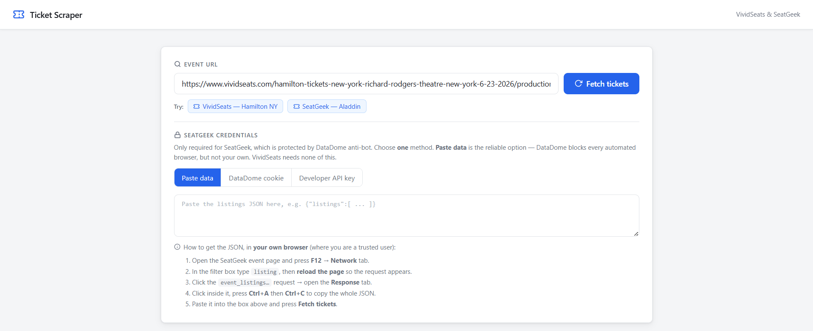
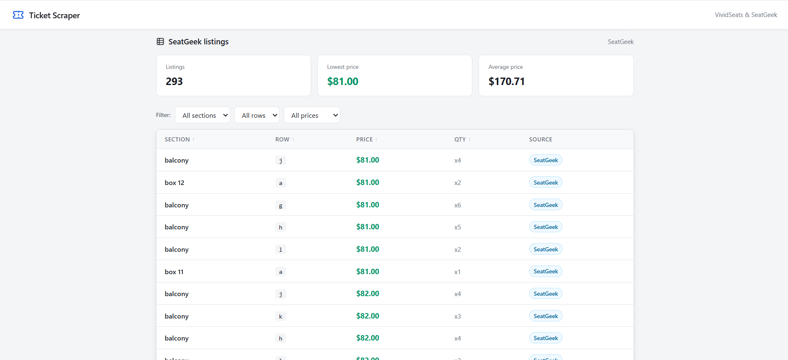
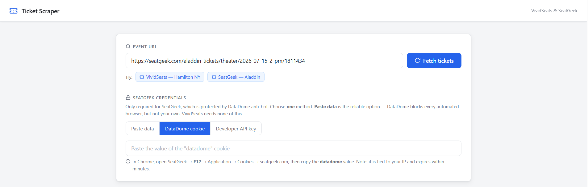
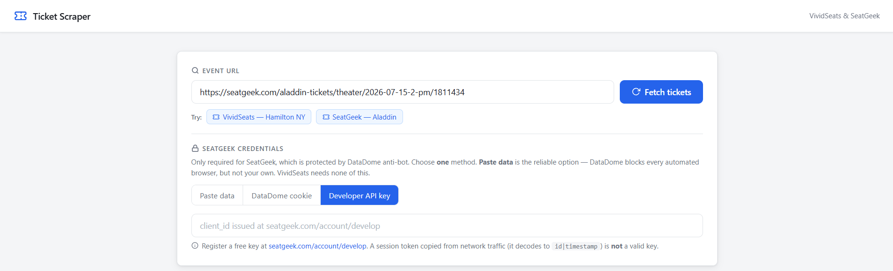
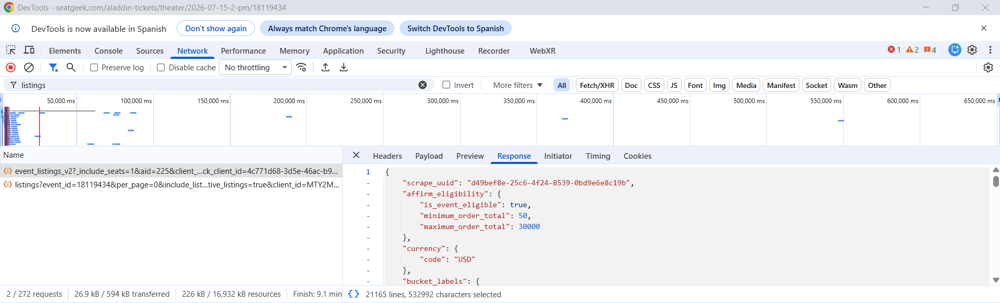
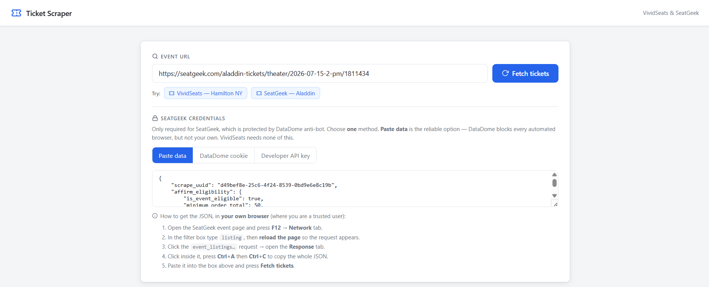

# Ticket Scraper

A small PHP + Node.js application that extracts live ticket listings — **section, row, price and quantity** — from event URLs on **VividSeats** and **SeatGeek**.

It ships with a clean **MVC** backend, a polished web UI (filters, sorting, pagination) and a CLI entry point. The project deliberately treats two scenarios differently, because the two platforms have very different anti-bot postures:

| Scenario | Platform | Status |
|---|---|---|
| **1** | VividSeats | ✅ **Fully working** |
| **2** | SeatGeek | ⚠️ **Controlled partial integration** (blocked by DataDome perimeter security — see [Scenario 2](#scenario-2--seatgeek-controlled-partial-integration)) |

---

## Screenshots

**Web interface** — SeatGeek "Paste data" method with step-by-step guidance:



**SeatGeek listings loaded** (section, row, price, quantity) with stats, filters and sorting:



---

## Why two scenarios

Both platforms hide their listings behind bot protection, but of different strength:

- **VividSeats** uses PerimeterX, which can be satisfied by executing the page's JavaScript in a real headless browser. A stealth-configured Chromium passes the challenge, so the integration is **complete and reliable**.
- **SeatGeek** uses **DataDome**, which fingerprints the IP, the TLS/HTTP signature and the browser, and challenges anything it cannot positively identify. From an unattended server it returns a CAPTCHA challenge regardless of the headers or cookies replayed. This is documented honestly below as a **partial integration**, with the failure path fully controlled.

The engineering point of this project is not "defeat DataDome at all costs" — that is neither realistic nor maintainable. It is to **build a clean integration where it is achievable, and degrade gracefully and transparently where it is not.**

---

## Architecture (MVC)

```
                 HTTP request
                      │
        ┌─────────────┴──────────────┐
        ▼                            ▼
  public/index.php            public/api.php
        │                            │
        ▼                            ▼
  HomeController              ApiController      ← validates input, formats JSON,
        │                            │             translates errors for the View
        ▼                            ▼
  View/home.php  ◄────────────  ScraperService   ← orchestration + try/catch boundary
   (HTML/JS UI)                      │
                                     ▼
                              node/scrape.js      ← scraping engine (Puppeteer + HTTP)
                                     │
                  ┌──────────────────┴───────────────────┐
                  ▼                                       ▼
        VividSeats (Hermes API                 SeatGeek (internal endpoint /
        intercepted via Puppeteer)             public API / stealth browser)
```

Responsibilities are strictly separated:

| Layer | File(s) | Responsibility |
|---|---|---|
| **Controller** | `src/Controller/*` | HTTP I/O, validation, error translation. Never scrapes. |
| **Model** | `src/Model/Ticket.php` | Immutable value object (`readonly` typed properties). |
| **Service** | `src/Service/ScraperService.php` | Bridges PHP ↔ Node, hydrates models, **exception boundary**. |
| **View** | `src/View/home.php` | Presentation only (HTML + vanilla JS). |
| **Engine** | `node/scrape.js` | The actual scraping; isolated from PHP and swappable. |

PHP orchestrates and presents; Node does the browser automation it is best suited for. The two communicate over a simple, well-defined JSON contract.

---

## Tech stack

| Component | Version |
|---|---|
| PHP | 8.1+ (typed properties, `readonly`, `str_contains`) |
| Node.js | 18+ |
| Puppeteer + stealth plugin | headless Chromium automation |
| Dependencies | **None on the PHP side** — no framework |

---

## Installation

```bash
git clone <repo-url>
cd ticket-scraper
npm install          # downloads Puppeteer + a compatible Chromium
```

## Running it

**Web UI:**

```bash
php -S localhost:8080 -t public/
# open http://localhost:8080
```

**CLI:**

```bash
# Scenario 1 — VividSeats (no credentials needed)
php bin/scraper.php "https://www.vividseats.com/.../production/6204797"

# Scenario 2 — SeatGeek (optionally pass a credential; see below)
php bin/scraper.php "https://seatgeek.com/aladdin-tickets/theater/2026-07-15-2-pm/1811434"
```

---

## Scenario 1 — VividSeats (fully working)

The scraper opens the event page in a stealth headless browser and **intercepts the network response** of the platform's own internal listings API rather than scraping the DOM:

```
GET /hermes/api/v1/listings?productionId={id}
```

Listening on that response yields clean, structured data (`sectionName`, `row`, `allInPricePerTicket`, `quantity`) which is normalised into `Ticket` objects. Because the data comes straight from the API the browser itself calls, it is complete and stable, and PerimeterX is satisfied by the real browser execution.

---

## Scenario 2 — SeatGeek (controlled partial integration)

SeatGeek is protected by **DataDome**. The UI offers **three mutually-exclusive methods**; pick one:

**Method 0 — Paste data ✅ (the reliable one)**
The user opens the listings endpoint in *their own* browser — where they are a trusted human — and pastes the JSON response into the app. This is *operator-assisted ingestion*: it sidesteps the anti-bot wall entirely because the data is fetched by a real, trusted session, not by automation. It always works and requires no credentials. Parsed by `ScraperService::parsePastedSeatGeek()`.

**Method A — DataDome cookie** *(best-effort)*
1. Direct call to the internal endpoint `seatgeek.com/api/event_listings_v2`, replaying the `datadome` cookie plus desktop-Chrome headers and client hints.
2. Fallback: render the page in a stealth browser with the cookie pre-injected (headless, or visible via `SEATGEEK_HEADFUL=1` so a challenge can be cleared by hand).

**Method B — Developer API key** *(best-effort)*
3. The public API `api.seatgeek.com/2/listings` using the `client_id`.

> **Tested reality:** I could **not** get either the **DataDome cookie** or a **`client_id`** to work against SeatGeek — its API sits behind very strict perimeter security (DataDome) that rejects every automated client regardless of the cookie, headers, User-Agent or even a visible browser. Both methods were verified against the live platform and fail by design — see the analysis below. **Method 0 (paste) is therefore the supported, working way** to obtain SeatGeek data; Methods A and B remain in the code as documented, honest best-effort attempts.

The DataDome-cookie and Developer-API-key inputs are still present in the UI (mutually exclusive, one at a time), each with inline guidance:

| DataDome cookie (best-effort) | Developer API key (best-effort) |
|---|---|
|  |  |

### Method 0 walkthrough (the working path)

**1. Copy the listings JSON from your own browser** — `F12 → Network`, filter by `listing`, reload, open the `event_listings_v2` request's **Response**, then `Ctrl+A` / `Ctrl+C`:



**2. Paste it into the app** and press **Fetch tickets**:



The result is the fully-rendered listings table shown in [Screenshots](#screenshots) above.

### Why it is delivered as *partial* — the honest analysis

This is not a missing feature; it is a deliberate, documented decision backed by what the platform actually returns:

1. **The DataDome cookie is non-portable.** It is bound to the IP, User-Agent and TLS fingerprint of the browser that obtained it, and it expires within minutes. Replayed from a server it is rejected. Verified directly against the live endpoint:

   ```
   GET https://seatgeek.com/api/event_listings_v2?id=1811434
   → HTTP 403
   {"url":"https://geo.captcha-delivery.com/captcha/?initialCid=…"}   ← DataDome challenge
   ```

2. **The public Developer API no longer exposes listings.** `api.seatgeek.com/2/` serves events, venues and performers — but not per-listing section/row/price. So even a *valid* developer key cannot satisfy "sector, fila, precio".

3. **A browser session token is not a developer key.** A `client_id` copied from network traffic base64-decodes to `id|timestamp` (a web session token), which the public API rejects. The UI detects this shape and explains it rather than failing opaquely.

4. **Automated browsers are detected even when visible.** DataDome's client-side JavaScript fingerprints the automation layer itself (the CDP control channel, `navigator.webdriver`, etc.), so even a headful, stealth-patched Chromium is served the "we think you are a robot" page. The block is not about IP or headers — it is about the browser being driven by software.

**Conclusion:** automated access to SeatGeek is not achievable in a maintainable way; a production integration requires SeatGeek's **official Partner API** (commercial agreement) or a managed anti-bot/proxy service. The application therefore ships **Method 0 (operator-assisted paste)** as the supported way to ingest SeatGeek data, keeps Methods A/B as documented best-effort attempts, and degrades cleanly when they fail. This is a deliberate, transparent *partial-by-design* scope rather than a hidden limitation.

### What "controlled" means in the code

When SeatGeek cannot be reached, nothing crashes. The chain `node → ScraperService → ApiController` converts the block into a structured payload, and the UI renders a calm, explanatory amber notice instead of a stack trace:

```jsonc
{ "success": false, "restricted": true, "error": "SeatGeek access is restricted by external perimeter security (DataDome anti-bot)…" }
```

---

## Resilience & error handling

Failure is treated as a first-class path, not an afterthought:

- **`node/scrape.js`** — the entire entry point is wrapped so it **always prints exactly one JSON object** to stdout and never throws to the shell, whatever goes wrong.
- **`ScraperService::fetch()`** — a `try/catch (\Throwable)` boundary turns a missing binary, an empty subprocess result or malformed output into a controlled array.
- **`ApiController::fetch()`** — guards the service call and translates internal error codes (`BLOCKED:*`, `NOT_A_DEV_KEY`, …) into a single, user-friendly message. The HTTP response is always valid JSON.
- **The View** — distinguishes a genuine error (red) from an expected, gracefully-handled restriction (amber `restricted` notice).

The result: **the interface can never break**, regardless of what SeatGeek's perimeter security decides to return.

---

## Project structure

```
ticket-scraper/
├── bin/scraper.php              # CLI entry point
├── public/
│   ├── index.php                # → HomeController
│   └── api.php                  # → ApiController (JSON API)
├── src/
│   ├── Controller/              # HomeController, ApiController
│   ├── Model/Ticket.php         # immutable value object
│   ├── Service/
│   │   ├── ScraperService.php   # PHP ↔ Node bridge + exception boundary
│   │   └── ConsoleFormatter.php # CLI output
│   └── View/home.php            # web interface
├── node/scrape.js               # scraping engine (Puppeteer + HTTP)
└── README.md
```

---

## Known limitations

- SeatGeek listings require an official Partner API key or a managed anti-bot service; the bundled credential methods are best-effort and documented as such.
- The scraper depends on each platform's current internal API shape; a platform-side change may require updating `node/scrape.js`.

---

## License

MIT — Meng Fei Dai
